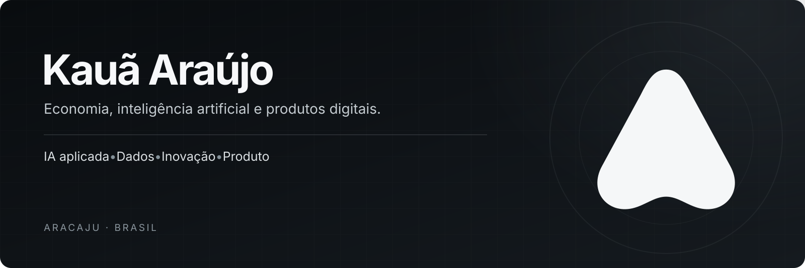
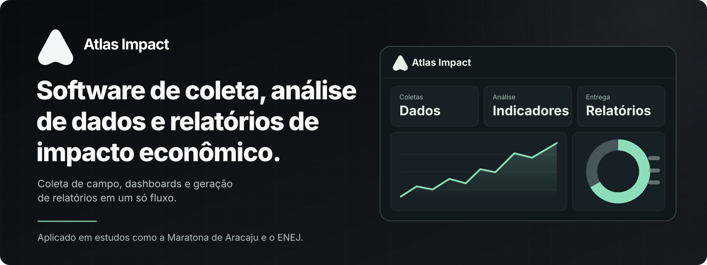
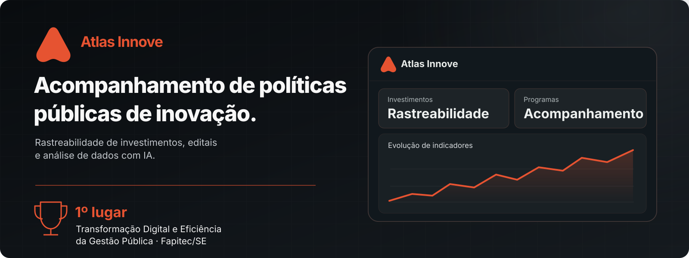

 

### Olá, sou o Kauã.

Estudo **Ciências Econômicas na Universidade Federal de Sergipe (UFS)** e trabalho na interseção de **inteligência artificial, dados, inovação e desenvolvimento de produtos digitais**.

Gosto de transformar problemas concretos em ferramentas que as pessoas realmente consigam usar — desde a ideia e o desenho da experiência até o produto funcionando.

Meu trabalho também envolve **estratégia, comunicação e empreendedorismo**. A tecnologia, para mim, é um meio de tornar informações mais claras e decisões mais inteligentes.

## Projetos em destaque

**[Atlas Impact — ver o projeto](projects/atlas-impact/README.md)**  
Software de coleta, análise de dados, dashboards e relatórios de impacto econômico. Utilizado em estudos associados à **Maratona de Aracaju** e ao **Encontro Nacional de Empresas Juniores (ENEJ)**. Em fase de pré-incubação para se tornar startup.

**[Atlas Innove — ver o projeto](projects/atlas-innove/README.md)**  
Plataforma de acompanhamento de políticas públicas de inovação, rastreabilidade de investimentos e análise de resultados. **1º lugar em Transformação Digital e Eficiência da Gestão Pública**, em premiação da Fapitec/SE.

Os links acima são estudos de caso públicos. Os produtos originais têm código-fonte privado.

## O que eu faço

| Produtos e IA | Economia e dados | Estratégia e inovação |
| :-- | :-- | :-- |
| Desenvolvimento assistido por **LLMs**, automações, prototipação e integração de soluções. | Estudos de impacto econômico, indicadores, análise e visualização de informações. | Criação de produtos, posicionamento, experiências digitais e novos negócios. |

## Ferramentas e tecnologias

> **Foco atual:** engenharia de produtos com IA, fluxos com LLMs e aplicações de dados. **Em estudo:** avaliação de modelos e Machine Learning.

## Além do código

Participo da construção de iniciativas ligadas a **empreendedorismo, tecnologia, educação e comunicação estratégica**. Minha formação em Economia influencia a maneira como penso problemas, métricas e impacto.

**Vamos conversar sobre produtos, dados e inovação.**  
[LinkedIn](https://www.linkedin.com/in/kauaaraujo/) · [Atlas Impact](https://atlas.ouseagency.com/) · [Ouse Agency](https://ouseagency.com/)

