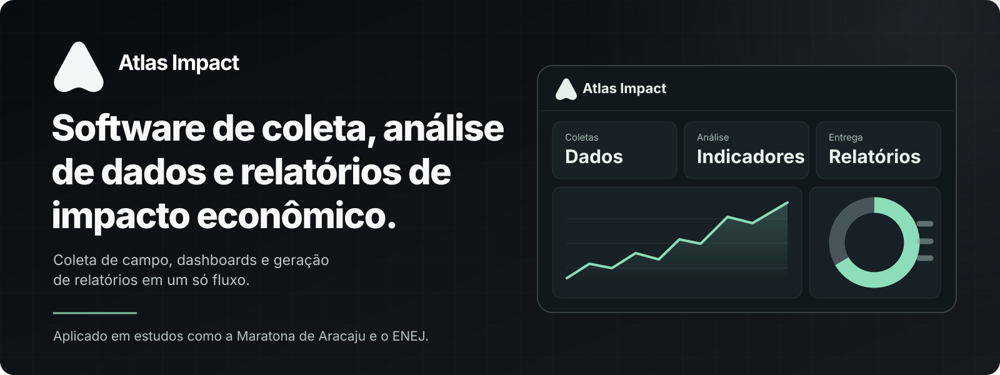
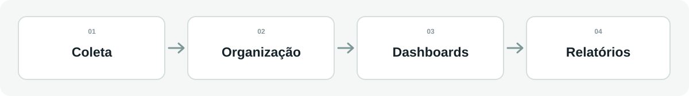

 

**Uma plataforma para transformar dados coletados em decisões mais claras.**

## O produto

O **Atlas Impact** reúne em um só lugar a **coleta de informações**, a **análise de dados**, os **dashboards interativos** e a **geração de relatórios** para estudos de **impacto econômico**.

Em vez de depender de formulários e planilhas desconectados, equipes conseguem acompanhar todo o trabalho em um fluxo contínuo — da pesquisa em campo à apresentação dos resultados.

## Aplicado em estudos reais

| Maratona de Aracaju | Encontro Nacional de Empresas Juniores (ENEJ) |
| :-- | :-- |
| Apoio à coleta e análise de informações relacionadas ao impacto econômico do evento. | Uso da plataforma em estudo de impacto econômico associado ao encontro. |
| **Eventos e economia local** | **Empreendedorismo e dados** |

## IA e automação na prática

| Construção do software | Fluxos de trabalho | Análise e entrega |
| :-- | :-- | :-- |
| Desenvolvimento assistido por IA, incluindo **Cursor** e ferramentas baseadas em **LLMs**. | Uso de **Zapier** em rotinas de automação e integração de processos. | Dashboards e **apoio de IA na preparação de relatórios**, transformando informações em resultados compreensíveis. |

## Da universidade à startup

O software está em **fase de pré-incubação e estruturação como startup**, em parceria com a **Universidade Federal de Sergipe (UFS)**, **SergipeTec**, **Agitte/SE** e **Innovation Center**, conforme o contexto institucional do projeto.

---

**Sobre esta página:** vitrine pública de produto e portfólio. O código-fonte original permanece em repositório privado. As ilustrações são conceituais, não telas reais nem dados dos participantes dos estudos.

[**Explorar o Atlas Impact**](https://atlas.ouseagency.com/) · [**Perfil de Kauã Araújo**](https://github.com/kauzone11)

