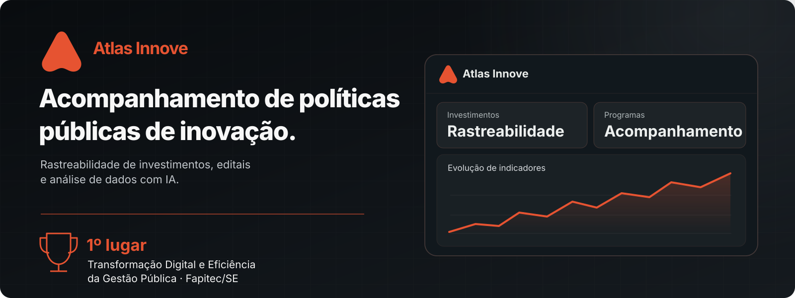
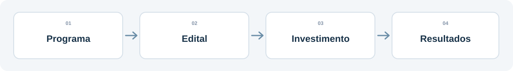

 

**Mais transparência sobre o caminho do investimento público — do edital aos resultados.**

## Reconhecimento

> **1º lugar — Transformação Digital e Eficiência da Gestão Pública**, em premiação promovida pela **Fapitec/SE**.

## O produto

O **Atlas Innove** é uma plataforma para **acompanhar políticas públicas e programas de incentivo à inovação**. Sua proposta é tornar os investimentos mais rastreáveis e transparentes, permitindo acompanhar o que acontece **depois da seleção e do apoio a cada projeto**.

A rastreabilidade dos registros ajuda gestores a identificar inconsistências e **prevenir irregularidades**, fortalecendo a prestação de contas. Não se trata de uma promessa de eliminar toda fraude.

## O que a plataforma reúne

| Acompanhamento | Oportunidades com IA |
| :-- | :-- |
| Histórico de programas, editais, investimentos e evolução dos empreendimentos apoiados. | Busca e organização de editais e oportunidades, com recursos de inteligência artificial. |

| Rede integrada | Inteligência de dados |
| :-- | :-- |
| Espaço de conexão e interação entre pessoas, organizações e participantes do ecossistema. | Dashboards e análise de informações para apoiar decisões e avaliações. |

## Fontes públicas e integrações

O sistema utiliza **APIs e bases públicas** para conectar informações sobre **programas e editais abertos**, além de consultas a **dados cadastrais, como CNPJ**. A proposta é reduzir a fragmentação e organizar informações que normalmente estão espalhadas por diferentes canais.

## Tecnologia aplicada a problemas públicos

**IA aplicada · LLMs · APIs · análise de dados · produto digital**

O produto segue em desenvolvimento e já reúne módulos avançados de acompanhamento, integração de informações e colaboração.

---

**Sobre esta página:** apresentação pública de um produto proprietário. O código-fonte original permanece privado. A ilustração é conceitual e não representa dados reais. A descrição da premiação e das integrações parte das informações fornecidas pelo responsável pelo projeto.

[**Perfil de Kauã Araújo**](https://github.com/kauzone11)

